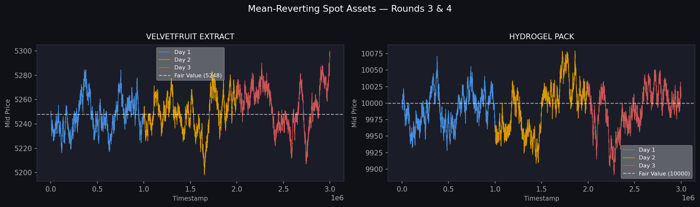
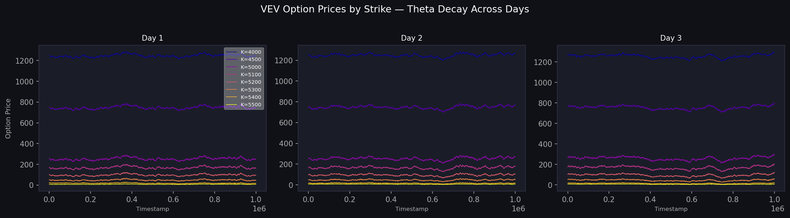
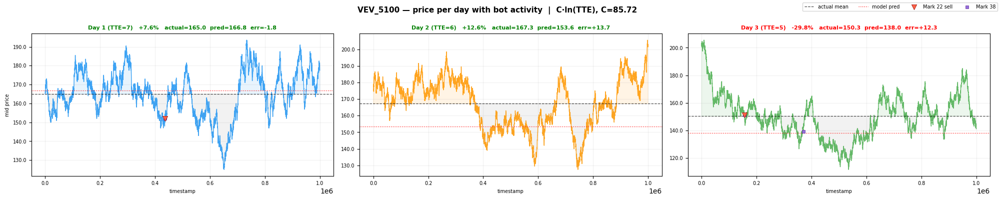
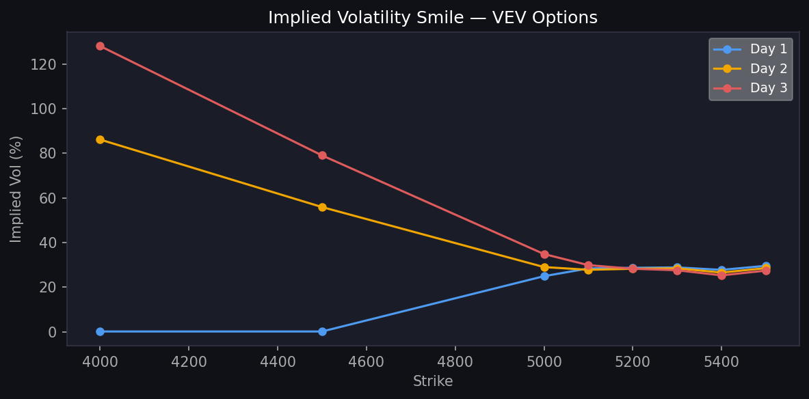
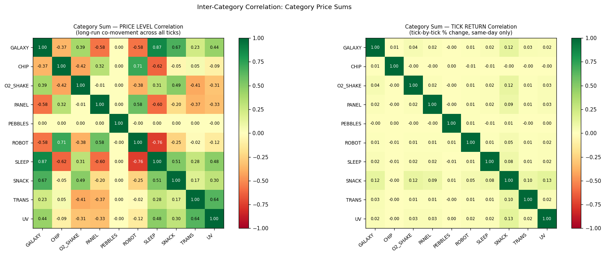
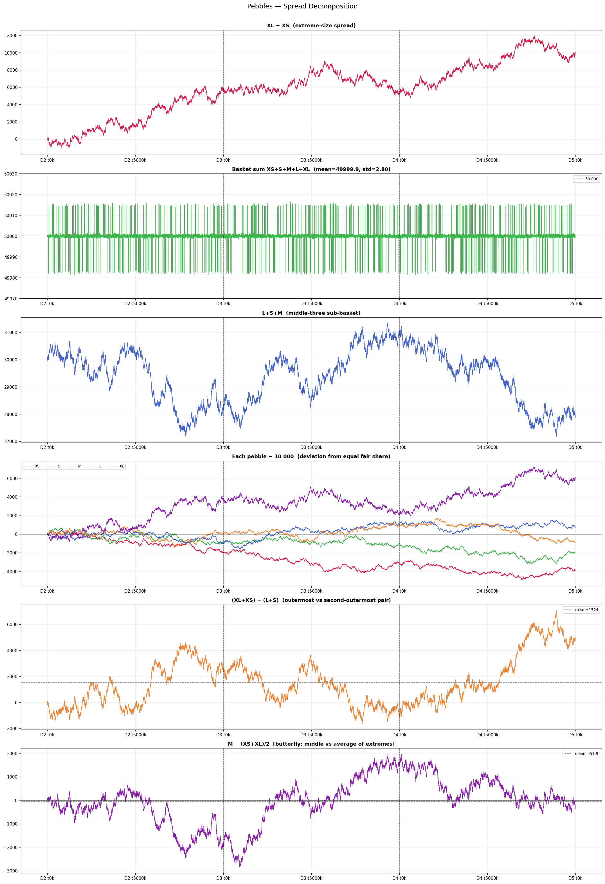
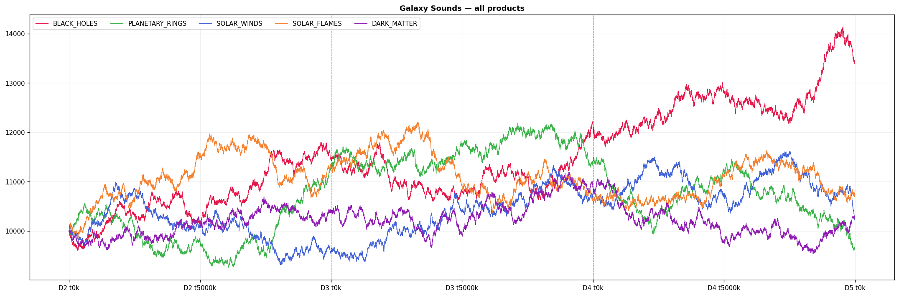
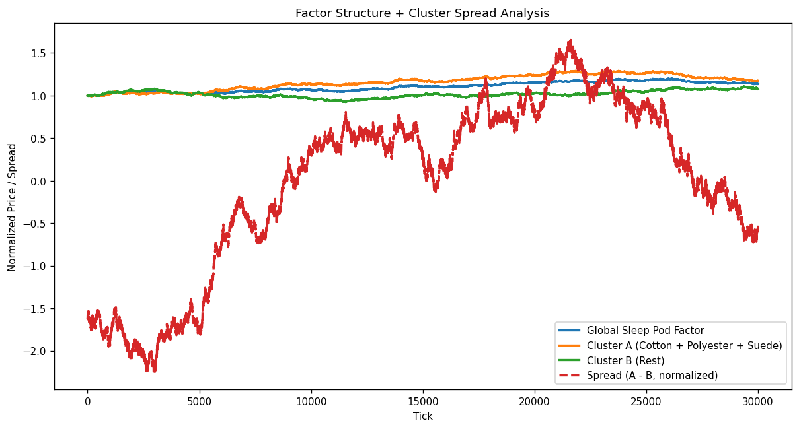

# IMC Prosperity 4

This is **Team TRITONS'** work on the algorithmic trading portions of IMC Prosperity 4, a global competition with 18,000+ teams. We finished **#122 globally**. This repo contains our final algorithms and exploration notebooks for Rounds 3-5 of the competition, which introduced progressively more complex products and market dynamics each round.

---

## Table of Contents
- [Rounds 3 & 4: Mean Reversion + Options Market Making](#rounds-3--4)
- [Round 5: Multi-Strategy Across 50 Products](#round-5)

---

## Rounds 3 & 4

Two products and their options were available: **HYDROGEL PACK** (spot ~10,000) and **VELVETFRUIT EXTRACT** (spot ~5,248), along with VEV call options at strikes 4000-6500.

### Spot Assets: Mean Reversion Market Making

Both spot products exhibited strong mean-reverting behavior around stable fair values. The strategy maintained a fixed fair value (FV) per product calibrated from historical data, then:

- Computed the deviation of the current mid-price from FV
- Set a target inventory proportional to `-deviation` (lean long when cheap, lean short when expensive)
- Posted three order layers: aggressive taker orders when misprice exceeded a threshold, passive inventory-skewed quotes, and penny-jump fills with remaining capacity
- Round 4 added realized volatility scaling, where the quote spread and position target scaled with a rolling vol ratio to adapt to regime changes

<p align="center">
  
</p>

*Mid-prices for both assets across 3 days, with fixed fair value reference lines. The prices oscillate tightly around FV, confirming the mean-reversion regime.*

---

### Options: Theta-Decayed Fair Values

Eight call options on VELVETFRUIT at strikes 4000-5500 were market-made using Black-Scholes calibrated fair values. The key insight was that each option's price decays predictably as expiry approaches.

**Round 3** used static BS fair values at TTE = 5 days, treating each option independently as a mean-reversion target around its BS price.

**Round 4** modeled the decay explicitly. For OTM strikes (5100-5500), the fair value followed:

$$FV(K, t) = C_K \cdot \ln(TTE)$$

where $C_K$ is a per-strike coefficient fitted from historical option prices and TTE decrements by 1 each day at end-of-day. This captured the accelerating theta decay of OTM options as expiry nears.

<p align="center">
  
</p>

*Option prices by strike across 3 days. Deep ITM options (low strikes) hold intrinsic value; OTM options decay toward zero, consistent with Black-Scholes theta.*

<p align="center">
  
</p>

*C·ln(TTE) model fit (dashed lines) vs actual observed option prices for OTM strikes. Bot trade prices are overlaid as scatter points, confirming the model captures the decay curve accurately.*

<p align="center">
  
</p>

*Implied volatility smile computed from median option prices across all strikes, shown per day. The smile is stable across days, validating the BS framework as the fair value anchor.*

Each option was traded with the same inventory-skewed MR approach as the spot assets, quoting around its BS fair value with aggression when the market price deviated beyond a strike-specific threshold.

---

### OTM Lottery: VEV 6000/6500 (Round 4 only)

A secondary bot (Mark 22) periodically dumped deep OTM options (VEV 6000/6500) at price 0. Another bot (Mark 01) rested bids to absorb them. The strategy raced Mark 01 by posting bids at the same or lower level and then offered inventory back at a floor ask price, capturing the spread on each dump cycle.

---

## Round 5

Round 5 introduced **50 new products** across 10 families of 5, each with a position limit of 50. The algorithm used a modular sector architecture where each product family is an independent strategy class with its own logic and state.

<p align="center">
  
</p>

*Return correlation between all 10 product categories. Low cross-category correlation confirmed each family required an independent strategy.*

---

### PEBBLES: XL/XS Pair Mean Reversion

Exploration revealed a structural basket constraint:

```
PEBBLES_XS + PEBBLES_S + PEBBLES_M + PEBBLES_L + PEBBLES_XL = 50,000  (std ~2.8)
```

<p align="center">
  
</p>

*The basket sum stays pinned at 50,000 throughout the round. Per-pebble deviations from their equal share of 10,000 are mean-reverting.*

This constraint implies XL and XS are negatively correlated. When one rises above its fair share, the other falls to compensate. The strategy traded the XL-XS spread directly, buying the cheap leg and selling the expensive leg when the spread deviated beyond a threshold. S, M, and L were handled with standalone passive market making.

---

### Trending Products: Trend-Hold + Market Making

Several families had persistent intra-day and multi-day directional trends. Rather than using a lagging EMA, the strategy held a fixed directional position per product while providing passive liquidity around it to capture spread.

<p align="center">
  
</p>

*Galaxy Sounds products trending upward consistently across all days, with day-over-day base shifts of ~1,000. Each product was assigned a directional hold size and the algorithm worked toward that target each tick.*

Sleep Pods split into two structural clusters: Cotton/Polyester/Suede (Cluster A) and Lamb Wool/Nylon (Cluster B). While both clusters trended together globally, the A-B spread was strongly mean-reverting and was traded as a pair.

<p align="center">
  
</p>

*The global Sleep Pod factor and both cluster composites track closely, while the A-B spread oscillates with large amplitude, confirming the inter-cluster spread as a mean-reversion signal.*

UV Visors and Translators showed large cumulative drifts (e.g., UV\_VISOR\_AMBER -28.7%, UV\_VISOR\_RED +17.2%) and were traded with fixed directional biases plus a bot-behavior learning signal.

---

### Pair and Cross-Cluster Mean Reversion

- **ROBOT\_DISHES / ROBOT\_IRONING**: negatively correlated pair. When the z-score of the spread exceeded 2.2, the strategy went long the laggard and short the leader, then flattened when the spread converged below 0.5.
- **Cross-cluster**: UV\_VISOR\_RED, ROBOT\_DISHES, SNACKPACK\_RASPBERRY, and SNACKPACK\_STRAWBERRY were grouped into a cross-family cluster. Each product held long (+5 baseline) with an MR overlay that fades deviations from the cluster mean price.
- **Snackpack**: CHOCOLATE, PISTACHIO, and VANILLA used passive market making. RASPBERRY and STRAWBERRY were handled by the cross-cluster sector above.
- **Remaining products** (Panels, Microchips, Oxygen Shakes, one Translator): passive penny-jump market making.

---

## Repository Structure

```
IMC Prosperity 4/
├── Final Algorithms/        submitted algorithms for each round
│   ├── round3_final.py
│   ├── round4_final.py
│   └── round5_final.py
├── Images/                  charts used in this README
└── round5_claudia.py        Round 5 working algorithm
```
