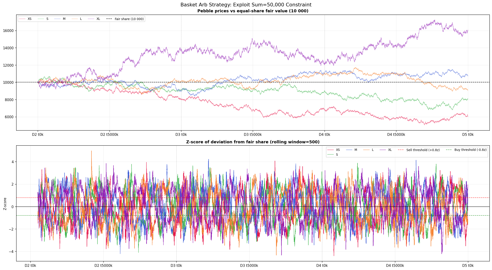
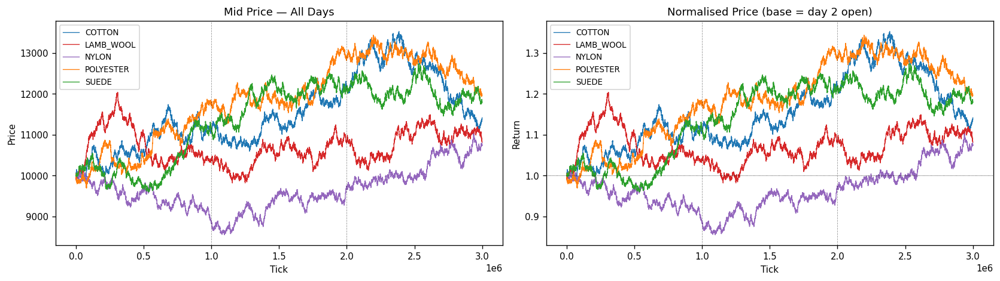
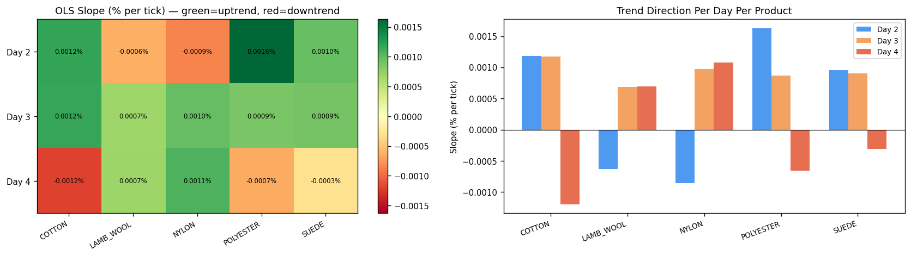

# IMC Prosperity 4

Algorithmic trading competition across 5 rounds. Each round introduced new products and market dynamics. This repo contains the final algorithms, exploration notebooks, and backtest logs for Rounds 3–5.

---

## Table of Contents
- [Rounds 3 & 4 — Mean Reversion + Options Market Making](#rounds-3--4)
- [Round 5 — Multi-Strategy Across 50 Products](#round-5)

---

## Rounds 3 & 4

Two products and their options were available: **HYDROGEL PACK** (spot ~10,000) and **VELVETFRUIT EXTRACT** (spot ~5,248), along with VEV call options at strikes 4000–6500.

### Spot Assets: Mean Reversion Market Making

Both spot products exhibited strong mean-reverting behavior around stable fair values. The strategy maintained a fixed fair value (FV) per product calibrated from historical data, then:

- Computed the deviation of the current mid-price from FV
- Set a target inventory proportional to `-deviation` (lean long when cheap, lean short when expensive)
- Posted three order layers: aggressive taker orders when misprice exceeded a threshold, passive inventory-skewed quotes, and penny-jump fills with remaining capacity
- Round 4 added realized volatility scaling — the quote spread and position target scaled with a rolling vol ratio to adapt to regime changes

<p align="center">
  
</p>

*Mid-prices for both assets across 3 days, with fixed fair value reference lines. The prices oscillate tightly around FV, confirming the mean-reversion regime.*

---

### Options: Theta-Decayed Fair Values

Ten call options on VELVETFRUIT at strikes 4000–5500 were market-made using Black-Scholes calibrated fair values. The key insight was that each option's price decays predictably as expiry approaches.

**Round 3** used static BS fair values at TTE = 5 days, treating each option independently as a mean-reversion target around its BS price.

**Round 4** modeled the decay explicitly. For OTM strikes (5100–5500), the fair value followed:

$$FV(K, t) = C_K \cdot \ln(TTE)$$

where $C_K$ is a per-strike coefficient fitted from historical option prices and TTE decrements by 1 each day at end-of-day. This captured the accelerating theta decay of OTM options as expiry nears.

<p align="center">
  
</p>

*Option prices by strike across 3 days. Deep ITM options (low strikes) hold intrinsic value; OTM options decay toward zero — consistent with Black-Scholes theta.*

<p align="center">
  
</p>

*C·ln(TTE) model fit (dashed lines) vs actual observed option prices for OTM strikes. Bot trade prices are overlaid as scatter points, confirming the model captures the decay curve accurately.*

<p align="center">
  
</p>

*Implied volatility smile computed from median option prices across all strikes, shown per day. The smile is stable across days, validating the BS framework as the fair value anchor.*

Each option was traded with the same inventory-skewed MR approach as the spot assets — quoting around its BS fair value with aggression when the market price deviated beyond a strike-specific threshold.

---

### OTM Lottery: VEV 6000/6500 (Round 4 only)

A secondary bot (Mark 22) periodically dumped deep OTM options (VEV 6000/6500) at price 0. Another bot (Mark 01) rested bids to absorb them. The strategy raced Mark 01 by posting bids at the same or lower level and then offered inventory back at a floor ask price — capturing the spread on each dump cycle.

---

## Round 5

Round 5 introduced **50 new products** across 10 families of 5, each with a position limit of 50. Products ranged from trending assets to basket-constrained pebbles to mean-reverting specialty goods.

<p align="center">
  
</p>

*Return correlation between all 10 product categories. Low cross-category correlation confirmed each family required an independent strategy.*

---

### PEBBLES: Basket Constraint Arbitrage

A structural invariant held throughout the round:

$$\text{PEBBLES\_XS} + \text{PEBBLES\_S} + \text{PEBBLES\_M} + \text{PEBBLES\_L} + \text{PEBBLES\_XL} = 50{,}000$$

<p align="center">
  
</p>

*Top panel: basket sum stays pinned at 50,000 (std ≈ 2.8). Lower panels: per-pebble deviations from their equal share of 10,000, confirming the basket constraint is enforced by the exchange.*

The strategy computed each pebble's basket-adjusted fair value as:

$$FV_i = \text{mid}_i + \frac{50000 - \sum_j \text{mid}_j}{5}$$

When the correction was large enough to cross the spread, the strategy traded aggressively; otherwise it fell back to passive penny-jump market making.

<p align="center">
  
</p>

*Rolling z-scores of per-pebble deviations from fair share. The z-scores are strongly mean-reverting, confirming the basket constraint as a reliable arbitrage anchor.*

---

### Trending Products: Linear Fair Value

Several product families exhibited persistent intra-day trends — prices drifted linearly throughout each day with a consistent per-day base shift. Using EMA-based fair values caused massive lag on these products, generating adverse selection.

The solution: a linear trend fair value model with day detection:

```
fair(t) = day_base + day_index × daily_drift + slope × timestamp
```

The algorithm detects new days by watching for timestamp resets (a drop of >500,000 in the timestamp counter), increments a day index, and adjusts the base price accordingly. It then trades aggressively when the market is below fair value and rests a bid ladder to capture dips.

**Galaxy Sounds** (5 products):

<p align="center">
  
</p>

*All 5 Galaxy Sounds products across all days. The products trend upward consistently, with day-over-day base shifts of ~1,000 per product.*

**Sleep Pods** (5 products):

<p align="center">
  
</p>

*Absolute mid-prices for all Sleep Pod variants. Day-to-day and intra-day trend magnitudes vary by product.*

<p align="center">
  
</p>

*OLS slope heatmap per product per day. Consistent sign and magnitude across days confirmed the trend was structural, not noise.*

<p align="center">
  
</p>

*Two distinct clusters emerged: Cotton/Polyester/Suede (Cluster A) and Lamb Wool/Nylon (Cluster B), moving together within each cluster but diverging across clusters.*

---

### Mean-Reverting Products: Fast EMA + Aggressive Fill

Four products showed strong negative autocorrelation: **ROBOT\_DISHES** (AC1 = −0.23), **ROBOT\_IRONING** (−0.13), **OXYGEN\_SHAKE\_EVENING\_BREATH** (−0.12), **OXYGEN\_SHAKE\_CHOCOLATE** (−0.09).

These used a fast EMA (α = 0.01, half-life ~70 ticks) as a fair value anchor. When the mid-price deviated beyond a per-product threshold, the strategy hit the opposing side aggressively (up to 10 lots). When no signal was present, it fell back to passive penny-jump market making.

---

### Stable Products: EMA Market Making

**SNACKPACK** (3 stable variants) had highly stable intra-day fair values with minimal drift. A slow EMA (α = 0.0002, half-life ~3,500 ticks) tracked the fair value reliably. Quotes were posted symmetrically around the EMA with inventory-based skewing to manage position risk.

---

### All Others: Penny-Jump Market Making

The remaining 30+ products across Translators, Panels, UV Visors, Microchips, and remaining Oxygen Shakes used market-relative quoting with no EMA:

- **Spread ≥ 3**: quote at `best_bid + 1` / `best_ask − 1`
- **Spread = 2**: join the best bid and ask
- **Spread = 1**: skip (no profit margin)
- Inventory cap at ±30 (60% of limit) — stop quoting one side when approaching limits to avoid large directional exposure on trending products

---

## Repository Structure

```
IMC Prosperity 4/
├── Data/                   — Raw price and trade CSVs (ROUND_3, ROUND_4, ROUND_5)
├── Final Algorithms/       — Submitted algorithms for each round
│   ├── round3_final.py
│   ├── round4_final.py
│   └── round5_final.py
├── Images/                 — Charts used in this README
├── old models/             — Exploration notebooks and prior algorithm iterations
└── round5_claudia.py       — Current working algorithm
```
